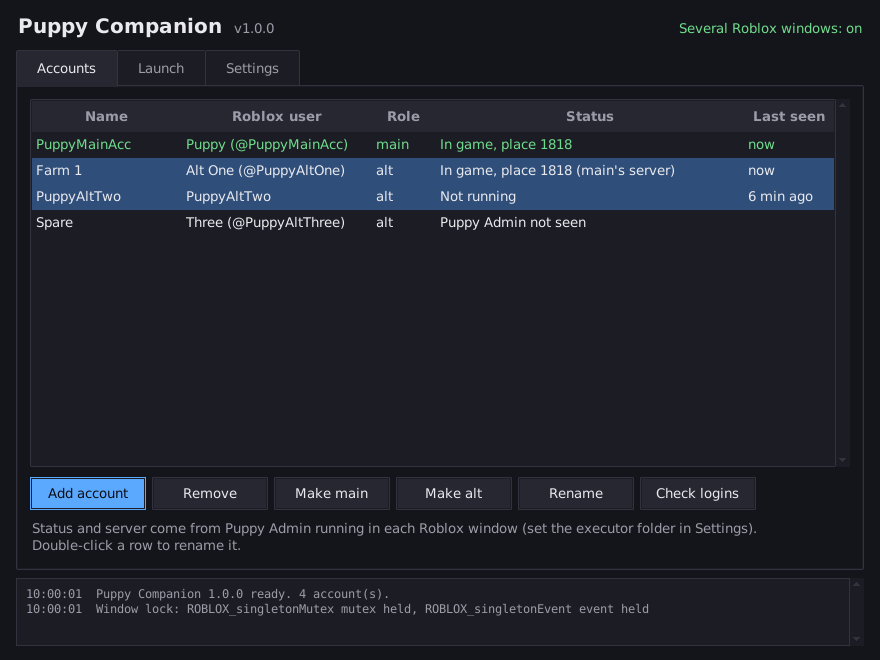
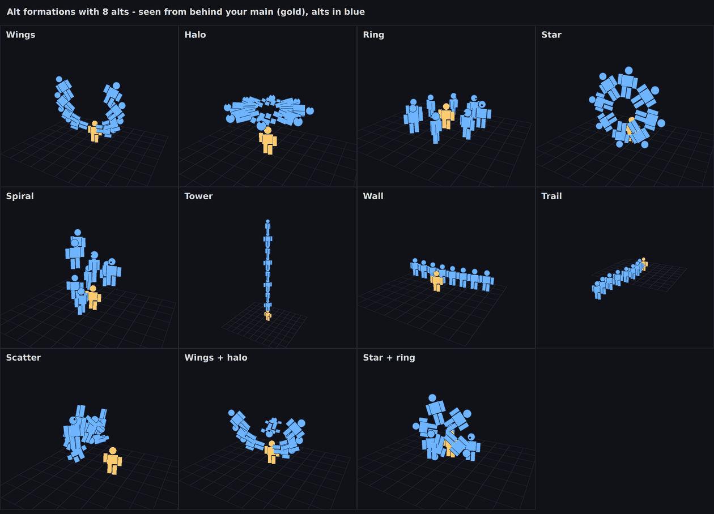

# Puppy Companion

The desktop half of Puppy Admin's alt-account support, for Windows. It:

- keeps your Roblox accounts, with each login cookie encrypted for your Windows user (Windows DPAPI);
- launches accounts into a game, a given server, or your main account's server, with several Roblox windows open at once;
- shows what Puppy Admin reports from each window: in a game or not, which place, whether an alt is in the main's server;
- writes the list of which account is the main and which are alts, for Puppy Admin's alt mode (coming next).

## Get it

- **Download:** on GitHub open *Actions*, then *Puppy Companion*, then the newest green run, and download the artifact `PuppyCompanion-win64`. Unzip it anywhere and run `PuppyCompanion\PuppyCompanion.exe`. The program is not code-signed, so Windows SmartScreen asks first (*More info*, then *Run anyway*). Some antivirus programs flag programs built with PyInstaller by mistake.
- **Build it yourself:** install Python 3.10 or newer from python.org and run `companion\build.bat`. It runs the tests, builds `companion\dist\PuppyCompanion\PuppyCompanion.exe` and runs its self-test.
- **Run from source:** `python companion\run_companion.py` (Python 3.10 or newer, nothing else to install).

## First start

1. **Settings, Executor folder:** press *Find*, or *Browse* to your executor's `workspace` folder (the one that holds the `PuppyAdmin` folder). The status line turns green once Puppy Admin has run there.
2. **Settings, Add Puppy Admin to auto-execute** (optional): writes the Puppy Admin loader into the executor's auto-execute folder, so every Roblox window the executor attaches to runs Puppy Admin and reports to the companion.
3. **Accounts, Add account:** paste the account's `.ROBLOSECURITY` cookie. To get it, log in to that account in a private browser window, press F12, open *Application*, *Cookies*, `https://www.roblox.com`, and copy the value of `.ROBLOSECURITY`. Then close the private window without logging out: logging out ends that cookie. The companion checks the cookie with Roblox before saving it.
4. Select your main account and press **Make main**. Every other account is an alt.

## Launch

On the **Launch** tab enter a game (a place ID such as `1818`, or a game link) and, if you want one server, its server ID (JobId). Then:

- **Launch selected accounts:** the accounts selected on the Accounts tab.
- **Launch all alts.**
- **Send alts to main's server:** finds the main's server (from Puppy Admin's report, or from Roblox's presence data when Puppy Admin is not running on the main) and launches every alt there. Alts that are already in that server are skipped.
- **Use main's server** fills in the game and server fields the same way.

Accounts start one after another, 8 seconds apart by default, so each Roblox window can open before the next. **Stop** drops the launches still waiting. **Close every Roblox window** ends every `RobloxPlayerBeta.exe`.

### Several Roblox windows

Roblox lets one window run at a time by holding a named lock. The companion takes that lock first and keeps it while it runs, so more windows can open. Start the companion before any Roblox window. If Roblox was already open, the header says so: close every Roblox window and press *Apply* in Settings. The lock names are in Settings in case Roblox changes them.

## Alt formations (in game)

Your alts can take a shape around your main that **everyone in the server sees**: the shape is made of the alts' own characters, so nothing extra has to replicate.

1. Get the alts into your main's server (Launch tab: *Send alts to main's server*). Each alt needs Puppy Admin running (auto-execute).
2. On your main, open **Alt formations**: the `alts` command, or the button at the bottom of Puppy Admin's Settings. It lists your alts as *ready*, *here, Puppy Admin not running*, *in another server* or *not playing*.
3. Pick a shape and press **Start**. Size, Speed and Height sliders, plus the Glitch, Spin and Pulse switches, change the shape live. **Stop** (or `unform`) lands the alts beside you.

Shapes: Wings, Halo, Ring, Star, Spiral, Tower, Wall, Trail (follows the path you walk), Scatter, and two mixes: Wings + halo (4 or more alts) and Star + ring (5 or more). From chat or the terminal: `form wings`, `form halo 1.5` (with a size), `unform`.

How it works: your main writes `PuppyAdmin/companion/altcmd.json` in the executor folder, and every alt on this PC reads it four times a second. An alt in the same server then places its own character every frame (it passes through walls and other players while it does), aiming slightly ahead of where it sees your main so it keeps up while you move. On your screen the alts never push you. Alts stop when your main's script stops, when the command is more than 25 seconds old (your main refreshes it every 5 seconds), or when they are not in your server. Alts on another PC cannot read this file, so formations need every account on the same PC.

## How status works

Puppy Admin (build `2026.11.24-44` or newer) writes `PuppyAdmin/companion/<UserId>.json` in the executor's workspace every 10 seconds: user ID and name, place ID, server ID, player count, and its build. `stop` and `kill` mark it offline. A window that has not written for 35 seconds counts as not running. The companion writes `PuppyAdmin/companion/roster.json` next to them: the user IDs and names of the main and the alts, never a cookie.

## Your data

Everything lives in `%APPDATA%\PuppyCompanion`:

| File | What is in it |
| --- | --- |
| `accounts.json` | User IDs, names, roles, and each login cookie encrypted with DPAPI. Only your Windows user on this PC can decrypt it. |
| `settings.json` | Executor folder, launch delay, lock names, last game and server. Nothing secret. |
| `companion.log` | The log you see at the bottom of the window. Cookies are masked even if an error message contained one. |

Login cookies are only ever sent to roblox.com: to check the login, to ask for a one-time launch ticket (Roblox receives the ticket, not the cookie, in the launch link), and to read the main's presence. Removing an account deletes its saved cookie. Anyone who has a cookie can log in as that account, so never paste one anywhere else.

## Self-test

`PuppyCompanion.exe --selftest report.txt` checks login encryption, the account file, the window lock, the launch link, the executor-folder files and the window, using a temporary folder and made-up names, and exits with code 0 when everything passes. It sends nothing to Roblox and does not touch your accounts or Roblox's lock.

## Not verified against Roblox yet

These depend on Roblox and can change without notice; they are kept in `puppy_companion/launch.py` and `puppy_companion/roblox.py`:

- the launch ticket request (`auth.roblox.com/v1/authentication-ticket`) and the `roblox-player:` launch link format;
- the single-window lock names `ROBLOX_singletonMutex` and `ROBLOX_singletonEvent` (editable in Settings);
- whether a Roblox client can tell that its server is a private server. Alts cannot be sent into a private server by server ID.

If a launch fails, the log line says what Roblox answered.

## Source

| File | Role |
| --- | --- |
| `run_companion.py` | Entry point (and `--selftest`). |
| `puppy_companion/app.py` | The window. |
| `puppy_companion/store.py` | Accounts and settings files. |
| `puppy_companion/secure.py` | DPAPI encryption. |
| `puppy_companion/roblox.py` | The Roblox web requests. |
| `puppy_companion/launch.py` | Launch links, the window lock, closing Roblox. |
| `puppy_companion/launch_queue.py` | Launches one after another on a worker thread. |
| `puppy_companion/workspace.py` | Status files, roster, auto-execute, finding the executor folder. |
| `puppy_companion/selftest.py` | The built-in checks. |
| `../tools/test_alts.lua` | Tests Puppy Admin's alt formations (shapes, command file, window) under Lua 5.4: `lua5.4 tools/test_alts.lua PuppyAdmin.lua` from the repository root. |
| `tools/make_icon.py` | Draws the icon (`assets/PuppyCompanion.ico`, `puppy_companion/icon_data.py`). |
| `tests/` | `python -m unittest discover -s tests` (window tests need a display and are skipped without one). |
